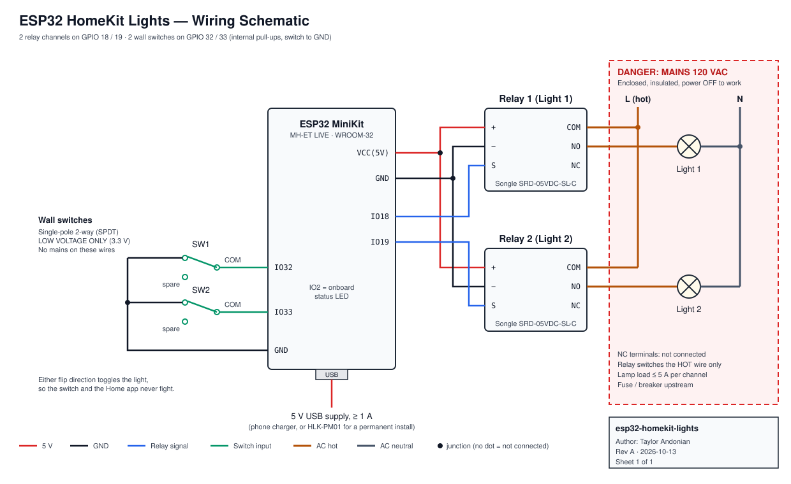

# ESP32 HomeKit Lights

Control two lights from the **Apple Home app** (and Siri, Control Center, automations) using an ESP32 and two relay modules. Each light also has a normal **wall switch**, and the wall switch and the Home app always stay in sync.



## Features

- Two lights show up natively in Apple Home. No bridge, hub, or extra app needed.
- Works with Siri ("Hey Siri, turn on Light 1"), Control Center, scenes, and automations.
- Physical wall switch for each light. **Either flip direction toggles the light**, so the switch never fights the app.
- Remembers each light's state through power outages.
- Lights default to OFF if the ESP32 loses power (relays wired normally-open).
- WiFi setup over USB or a phone-friendly setup hotspot, with no credentials hard-coded.

## How it works

The ESP32 runs **[HomeSpan](https://github.com/HomeSpan/HomeSpan)**, an Arduino library that speaks Apple's HomeKit Accessory Protocol. It makes the ESP32 look like any store-bought HomeKit device, so iOS's built-in **Home** app can find it and control it over your WiFi. Nothing gets installed on the iPhone.

```
 iPhone (Home app / Siri)
          │ WiFi (HomeKit)
          ▼
 ┌──────────────────┐   IO18 ──► Relay 1 ──► Light 1
 │  ESP32 MiniKit   │   IO19 ──► Relay 2 ──► Light 2
 │  HomeSpan        │   IO32 ◄── Wall switch 1
 └──────────────────┘   IO33 ◄── Wall switch 2
```

## Hardware

| Part | Qty |
|------|-----|
| MH-ET LIVE ESP32 MiniKit | 1 |
| Songle SRD-05VDC-SL-C single relay module | 2 |
| Single-pole 2-way light switch | 2 |
| 5 V ≥ 1 A USB supply | 1 |
| 3D-printed enclosure (box + back plate) | 1 set |

Full list with wiring supplies and optional parts: **[hardware/BOM.md](hardware/BOM.md)** · [BOM.csv](hardware/BOM.csv)

### Pinout

| ESP32 pin | Connects to |
|-----------|-------------|
| VCC (5 V) | Relay 1 `+`, Relay 2 `+` |
| GND | Relay 1 `−`, Relay 2 `−`, switch travelers |
| IO18 | Relay 1 `S` (Light 1) |
| IO19 | Relay 2 `S` (Light 2) |
| IO32 | Switch 1 COM |
| IO33 | Switch 2 COM |

Step-by-step wiring, including the mains side and safety notes: **[docs/WIRING.md](docs/WIRING.md)**

### Enclosure

A two-piece 3D-printed enclosure (main box + back plate with mounting ears) is in **[hardware/enclosure/](hardware/enclosure/)** as STEP files, with print settings and assembly notes.

> ⚠ **The relay contacts switch 120 V mains.** Wire and test all the low-voltage parts first with no mains connected. Keep every mains terminal inside a closed enclosure, and turn the power off before touching it.

## Software setup

### 1. Install the tools

1. Install the [Arduino IDE](https://www.arduino.cc/en/software) (2.x).
2. **File → Preferences → Additional boards manager URLs**, add:
   `https://espressif.github.io/arduino-esp32/package_esp32_index.json`
3. **Tools → Board → Boards Manager**: install **esp32 by Espressif Systems** (version 3.x).
4. **Tools → Manage Libraries**: install **HomeSpan** by Gregg Berman (version 2.x).

### 2. Board settings

| Setting | Value |
|---------|-------|
| Board | **MH ET LIVE ESP32MiniKit** |
| Partition Scheme | **Minimal SPIFFS (Large APPS with OTA)** ← required, HomeSpan won't fit the default |
| Upload Speed | 921600 (drop to 115200 if uploads fail) |

### 3. Configure and upload

1. Open `firmware/HomeKitLights/HomeKitLights.ino`.
2. Edit **`config.h`** if you want different names, pins, or a different pairing code. Each setting is explained in the file.
3. Click **Upload**, then open **Serial Monitor** at **115200 baud**.

### 4. Connect to WiFi

Pick one:

- **Serial Monitor:** type `W` and press Enter, then follow the prompts to choose your network and enter the password.
- **Setup hotspot:** on first boot with no WiFi saved, the ESP32 creates a network called **`HomeSpan-Setup`** (password `homespan`). Join it from your phone and enter your WiFi details.

The ESP32 only supports **2.4 GHz** WiFi, and your iPhone must be on the same network.

### 5. Add to the Home app

1. Open **Home** on your iPhone → **+** → **Add Accessory**.
2. Tap **More options…**. "ESP32 Lights" appears in the list.
3. Tap it, accept the "Uncertified Accessory" prompt, and enter the code **466-37-726** (or your own from `config.h`).
4. **Light 1** and **Light 2** appear as separate lights. Rename them and assign them to rooms.

## Using it

| Action | Result |
|--------|--------|
| Tap a light in Home / Control Center | Relay toggles |
| "Hey Siri, turn off Light 2" | Relay turns off |
| Flip a wall switch (either way) | Light toggles, Home app updates instantly |
| Power outage | Lights come back in their last state |

The blue onboard LED shows status. It blinks while connecting or waiting to pair, and it's solid when paired and running.

## Configuration

Everything lives in [`firmware/HomeKitLights/config.h`](firmware/HomeKitLights/config.h):

| Setting | Default | Meaning |
|---------|---------|---------|
| `RELAY1_PIN` / `RELAY2_PIN` | 18 / 19 | Relay outputs |
| `RELAY_ACTIVE_LOW` | `false` | Set `true` if your relay modules are "low-level trigger" |
| `SWITCH1_PIN` / `SWITCH2_PIN` | 32 / 33 | Wall switch inputs |
| `DEBOUNCE_MS` | 50 | Switch debounce time |
| `LIGHT1_NAME` / `LIGHT2_NAME` | "Light 1" / "Light 2" | Default names in Home |
| `PAIRING_CODE` | `46637726` | 8-digit HomeKit code |

## Repository layout

```
esp32-homekit-lights/
├── firmware/HomeKitLights/
│   ├── HomeKitLights.ino     Main sketch
│   └── config.h              Pins, names, pairing code
├── hardware/
│   ├── schematic.svg         Wiring schematic (vector)
│   ├── schematic.png         Wiring schematic (image)
│   ├── BOM.md                Bill of materials
│   ├── BOM.csv               Bill of materials (spreadsheet)
│   └── enclosure/
│       ├── main_switch_box.step   3D-printed main box
│       ├── switch_box_back.step   3D-printed back plate
│       ├── enclosure.png          Preview render
│       └── README.md              Print settings + assembly
├── docs/
│   ├── WIRING.md             Step-by-step wiring + mains safety
│   └── TROUBLESHOOTING.md    Common problems and fixes
├── .github/workflows/
│   └── build.yml             CI: compiles the firmware on every push
├── LICENSE
└── README.md
```

## Troubleshooting

See **[docs/TROUBLESHOOTING.md](docs/TROUBLESHOOTING.md)**. Quick ones:

- **Light inverted?** Set `RELAY_ACTIVE_LOW true`.
- **Sketch too big?** You missed the Minimal SPIFFS partition scheme.
- **Can't find it in Home?** The ESP32 has to be on the same 2.4 GHz WiFi as your iPhone.
- **Need to re-pair?** Type `U` in the Serial Monitor.

## License

MIT. See [LICENSE](LICENSE).

---

Built by [Taylor Andonian](https://github.com/TaylorAndonian).
