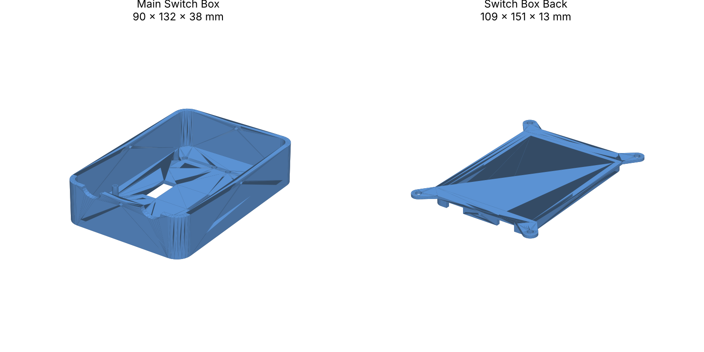

# Enclosure

A two-piece 3D-printed enclosure for the ESP32 MiniKit and both relay modules. Designed in Fusion 360.

| File | Part | Size (mm) |
|------|------|-----------|
| [`main_switch_box.step`](main_switch_box.step) | Main box: holds the ESP32 and relays | 90 × 132 × 38 |
| [`switch_box_back.step`](switch_box_back.step) | Back plate with 4 mounting ears, closes the box | 109 × 151 × 13 |

STEP files open in Fusion 360, SolidWorks, Onshape, FreeCAD, and most slicers (Bambu Studio, PrusaSlicer, OrcaSlicer). GitHub also shows a 3D preview when you click a file.

## Printing

- **Material:** PETG or ASA. They handle the relays' heat and are tougher than PLA. Avoid PLA if it sits in a warm wall box.
- **Layer height:** 0.2 mm
- **Walls:** 3–4 perimeters, so the box is solid around the mains terminals
- **Infill:** 20–30 %
- **Orientation:** print the main box open-side up and the back plate flat side down. Neither part needs supports.

## Assembly

1. Mount the ESP32 MiniKit and both relay modules inside the main box.
2. Route the mains wires so they stay on the relay side of the box, away from the ESP32 and the low-voltage switch wires.
3. Fit the back plate and screw it in, then mount the enclosure using the four ears on the back plate.

> ⚠ The enclosure is part of the mains safety. Never power the relays with the back plate off.
